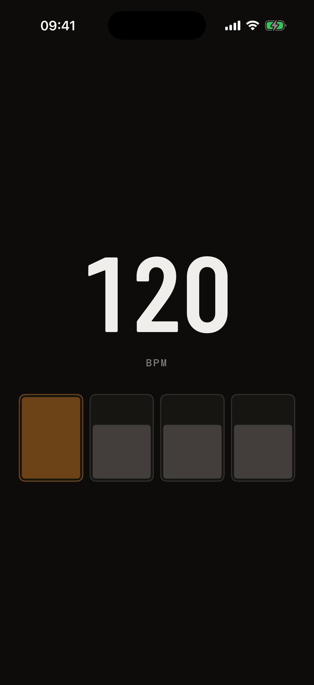
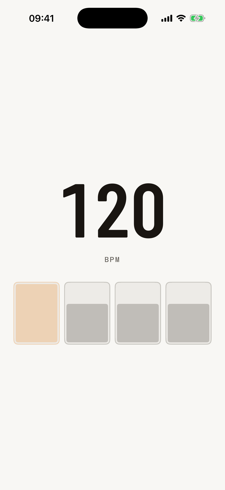
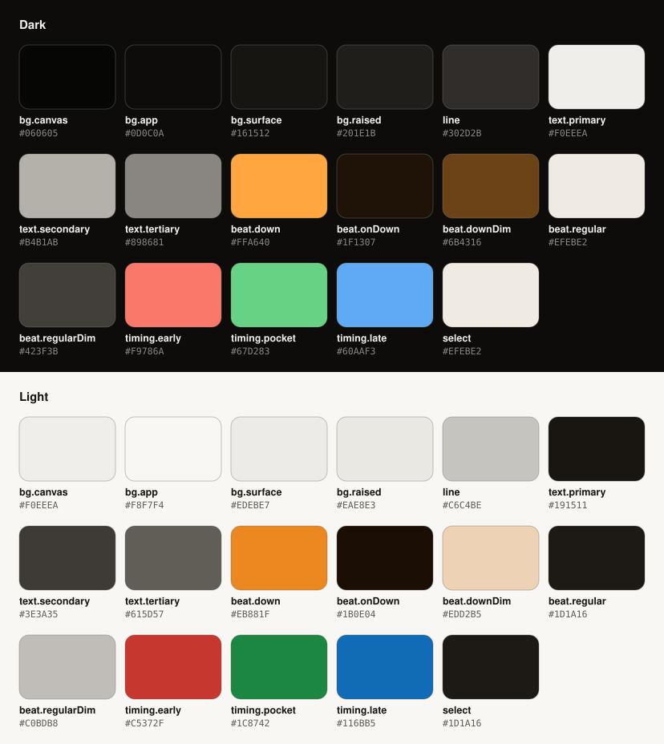

  

<h1 align="center">pocket</h1>

  <strong>A metronome that can also listen.</strong> 
  It keeps time, shows when you rush or drag, and trains you to hold the tempo when the click drops out. 
  iOS · Android · macOS

In development. The source is private; this page shows the product, the design and how it's built.

---

## Screenshots

The current build: Metronome home in dark and light, with the design system's fonts and colours.

| Dark | Light |
| :---: | :---: |
|  |  |

## What it does

| Area | What's in it |
| --- | --- |
| **Metronome** | 30 to 300 BPM, time signatures, subdivisions, swing, accents per beat, section markers, and a Stage view readable from the drum throne |
| **Practice** | Tempo ramps that step up every few bars, and timed sessions |
| **Trainer** | Drills where the click drops out, with per-hit scoring in milliseconds through the microphone |
| **Tools** | Tap tempo, Listen (finds the tempo of a song playing nearby), play-along with A–B loops, BPM ↔ ms |
| **Library** | Presets, setlists, a gig mode that counts in the next song with one tap, and practice history |

Everything works without the microphone. It only adds scoring and Listen, and audio never leaves the device.

## The design

**The visuals must never lag the click.** A beat that lights up even a frame late reads as dragging, so the
timing rules are part of the design, not polish:

- **Locked to the audio clock.** Clicks are scheduled ahead on exact samples, and each beat lights on the first
  frame at or after its scheduled time. Nothing is predicted.
- **Instant on.** A beat turns on in one frame at full brightness. No easing.
- **Tempo changes land on the next pulse.** Changing BPM mid-bar never stretches the current beat.
- **Accent is shape, not just colour.** A beat's level is shown by how full its cell is (100%, 66%, 34%, empty
  for muted), so it reads without colour.

**Colour** is defined in OKLCH. Amber marks the downbeat, and three separate hues show timing: early, in the
pocket, late. Light mode darkens them to keep contrast on beat cells and labels.

**Type:** Barlow Condensed for the BPM (up to 220 px in Stage), Hanken Grotesk for titles and body, and Chivo Mono
for labels like `BAR · BEAT`.

## How it's built

- **One C++ audio core, native apps.** The click scheduler is C++ with a C interface, shared by a SwiftUI app for
  iOS and macOS and a Jetpack Compose app for Android. Timing is identical everywhere because there is one
  implementation of it.
- **Timing rules are tested.** The core's tests check sample-exact placement, no drift over a ten-minute run,
  and that tempo and meter changes wait for the right moment.
- **One source for the design.** Colours, type, spacing and radii live in one token file, and a generator writes
  the Swift and Kotlin code from it. CI fails on hard-coded colours or font sizes.
- **CI/CD on GitHub Actions** with fastlane: every pull request is linted, tested and built for all three
  platforms. Tester builds go to Firebase and TestFlight, and releases to the stores.

## Roadmap

| Phase | What | Status |
| --- | --- | --- |
| Setup | Monorepo, audio core, design tokens, both app shells, CI/CD | ✅ Done |
| 1 · MVP metronome | Design foundation, real click on device, Metronome home, Stage mode, presets, onboarding | 🟡 In progress |
| 2 · Practice and Library | Tempo ramps, timed sessions, setlists, gig mode, history, tap tempo | ⏳ |
| 3 · Listening | Microphone calibration, Trainer drills with scoring, Listen mode | ⏳ |
| 4 · Play-along and extras | Song import with time-stretch, Live Activity, widgets, macOS menu bar, store release | ⏳ |

---

Made by Clement Babaniyi. Fonts: Barlow Condensed, Hanken Grotesk and Chivo Mono, under the SIL Open Font
License. Screenshots and design © Clement Babaniyi, all rights reserved.
